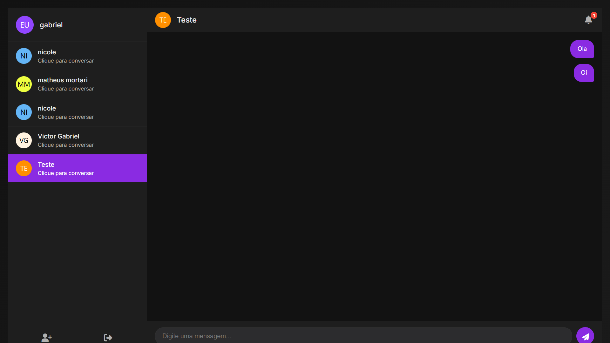
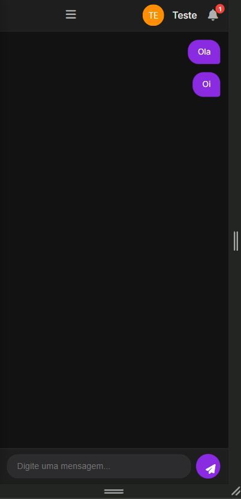
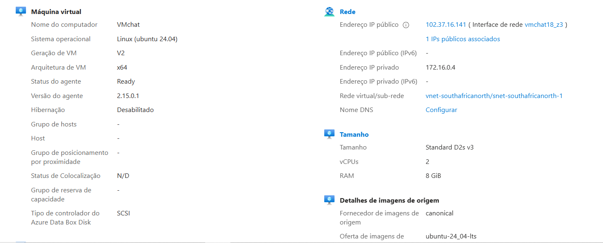

# 💬 Chat Online Application

  

Uma aplicação de chat em tempo real, desenvolvida para estudar integração de APIs, Node.js e infraestrutura em nuvem. O projeto é totalmente responsivo e permite a comunicação instantânea entre múltiplos usuários.

## 📸 Screenshots

| Desktop View | Mobile Responsividade |
|:---:|:---:|
|  |  |

*Deploy e Monitoramento na Azure:*


## 🚀 Tecnologias Utilizadas

* **Backend:** Node.js
* **Frontend:** HTML, CSS, JavaScript
* **Comunicação Real-Time:** Socket.io (Inferred based on functionality)
* **Banco de Dados:** SQLite (para persistência leve de mensagens)
* **Infraestrutura:** Microsoft Azure Virtual Machine (Linux)

## 🎯 Objetivos do Projeto

1.  **Estudo de JavaScript & Node.js:** Compreender o funcionamento do event-loop e gerenciamento de requisições no backend.
2.  **Comunicação em Tempo Real:** Implementar WebSockets para permitir a troca de mensagens instantânea sem refresh da página.
3.  **Infraestrutura & Cloud:**
    * Configuração de uma Máquina Virtual (VM) no Azure (Conta Estudante).
    * Administração básica de servidores Linux.
    * Deploy manual da aplicação em ambiente de produção.

## ⚙️ Como Rodar Localmente

Para executar este projeto na sua máquina:

1.  **Clone o repositório:**
    ```bash
    git clone [https://github.com/GRiguetto/Chat.git](https://github.com/GRiguetto/Chat.git)
    ```

2.  **Instale as dependências:**
    ```bash
    npm install
    ```

3.  **Inicie o servidor:**
    ```bash
    node server.js
    ```

4.  **Acesse:**
    Abra o navegador em `http://localhost:3000` (ou a porta definida no console).

## ☁️ Deploy na Azure

A aplicação foi hospedada em uma VM Azure para testar conectividade externa.
* **Status:** A aplicação demonstrou estabilidade e responsividade ao ser acessada por dispositivos distintos (Celular e PC) simultaneamente.
* **Monitoramento:** Acompanhamento de logs e status do servidor via terminal remoto.

## Autor

**Gabriel Fernandes Riguetto**
Projeto desenvolvido para fins de estudo e portfólio.

---
*Sinta-se à vontade para contribuir ou deixar uma estrela no repositório!*
